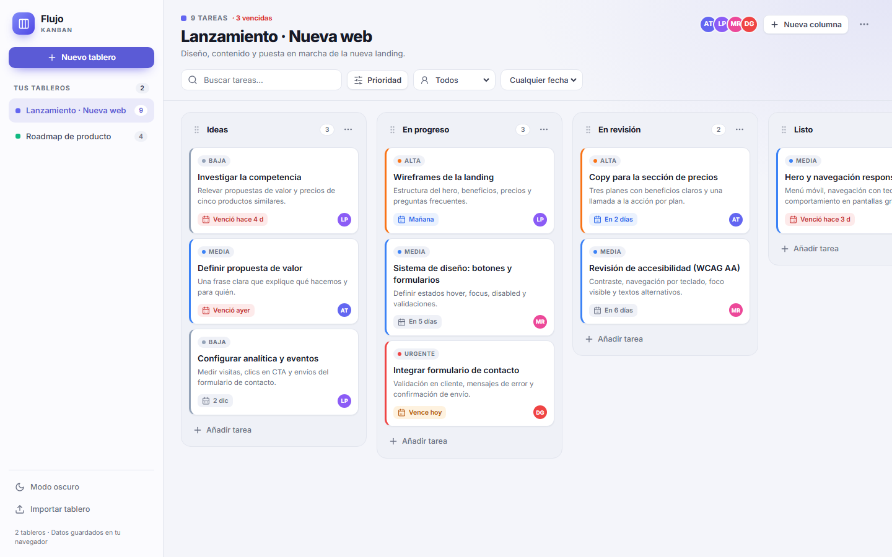
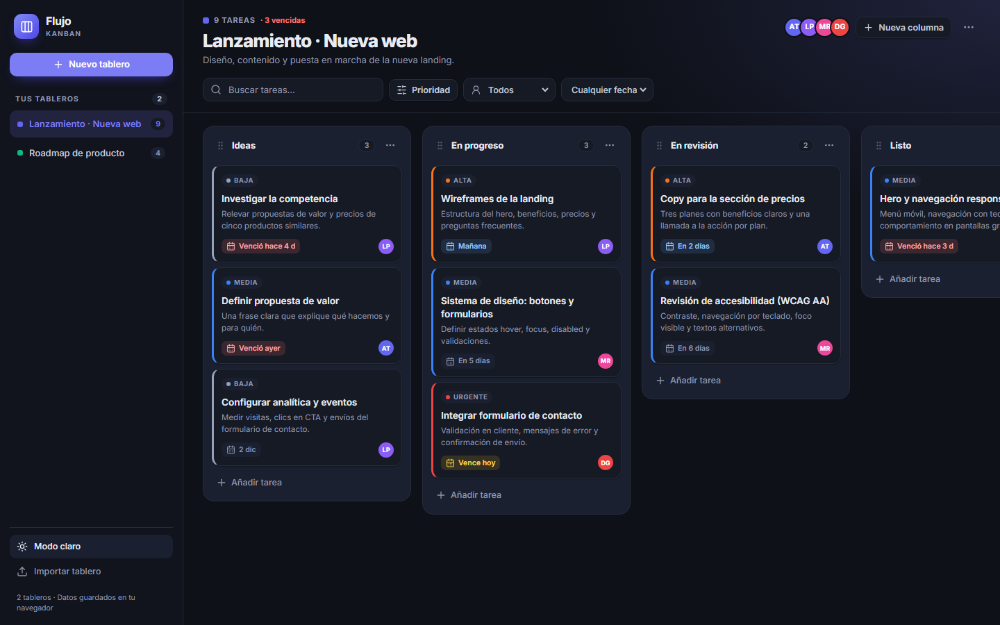
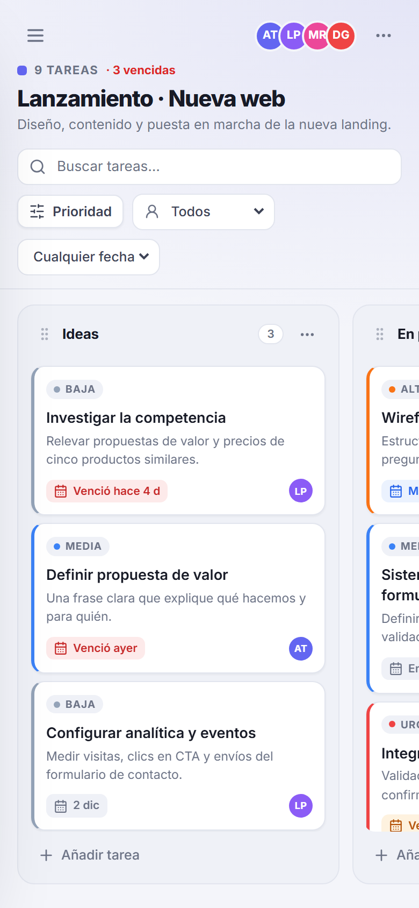
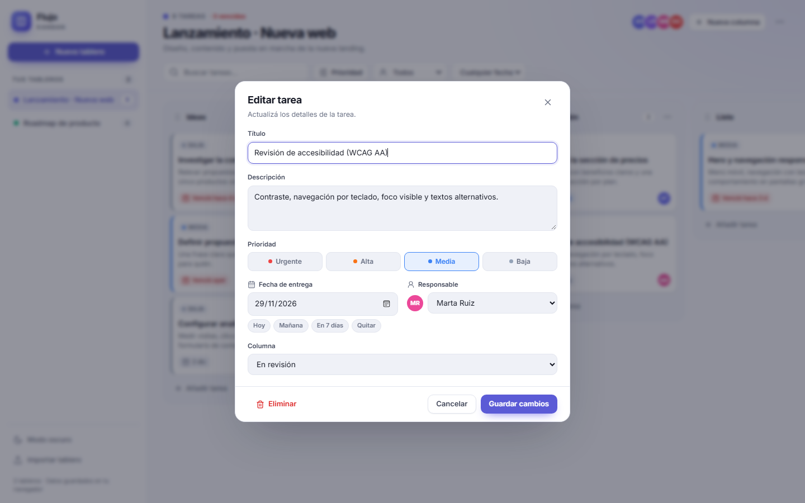

# Flujo · Open-source Kanban board

**English** · [Español](#español)

<div align="center">
  

  <h3>Organize your work, one card at a time.</h3>

  <p>
    A polished Kanban task manager built with <strong>React + TypeScript + Vite</strong>.<br />
    Boards, columns, tasks, priorities, due dates and collaborators — running 100% in the browser.
  </p>

  <p>
    
    
    
    
    
  </p>
</div>



## English

### Features

- **Boards** — create, edit and delete boards with a name, description and accent color.
- **Columns** — add, rename, delete and reorder columns with drag & drop.
- **Tasks** — title, description, priority (Low / Medium / High / Urgent), due date and assignee.
- **Drag & drop** — move tasks between columns and reorder them, with pointer **and keyboard** support.
- **Collaborators** — add people to a board, pick an avatar color and assign them to tasks.
- **Search & filters** — combine text search, priority, assignee and due-date filters.
- **Due-date awareness** — overdue, due today and upcoming tasks are highlighted automatically.
- **Dark / light theme** — persisted, and it respects your system preference on first visit.
- **Autosave** — everything is stored in `localStorage`; no account or backend required.
- **Export / import** — download a board as JSON and import it back later.
- **Undo** — restore deleted tasks and boards from the toast notification.
- **Installable PWA** — install it as an app on desktop or mobile and keep working offline.
- **Responsive** — designed for desktop, tablet and mobile.
- **Accessible details** — keyboard drag & drop, visible focus states, ARIA labels and reduced-motion support.

### Screenshots

| Dark theme | Mobile |
| :--------: | :----: |
|  |  |

| Task editor |
| :---------: |
|  |

### Tech stack

| Layer | Choice |
| --- | --- |
| UI | React 18 |
| Language | TypeScript (strict) |
| Build tool | Vite 6 |
| Drag & drop | [dnd-kit](https://dndkit.com/) |
| Icons | [lucide-react](https://lucide.dev/) |
| Styling | Hand-written CSS with design tokens and dark mode |
| PWA | vite-plugin-pwa + Workbox |
| Persistence | `localStorage` (no backend) |

### Getting started

```bash
# 1. Clone the repository
git clone https://github.com/Vlobos01/gestor-de-tareas.git
cd gestor-de-tareas

# 2. Install dependencies (Node 18+)
npm install

# 3. Start the dev server
npm run dev
```

Open **http://localhost:5173** — the app loads with two demo boards so you can explore it right away.

### Scripts

| Command | Description |
| --- | --- |
| `npm run dev` | Start the development server |
| `npm run build` | Type-check and build for production |
| `npm run preview` | Preview the production build |

### Install as an app (PWA)

The production build ships with a web app manifest and a service worker, so Flujo can be installed
like a native app and used offline after the first visit.

- **Chrome / Edge (desktop)** — click the install icon in the address bar, or use **Install application** in the sidebar.
- **Android (Chrome)** — open the browser menu and choose **Install app**.
- **iOS (Safari)** — tap **Share → Add to Home Screen**.

Offline mode caches the app shell, assets and fonts. Tasks and boards are still stored locally on
the device, so each installation keeps its own data.

### Project structure

```
src/
├── components/          # UI components and dialogs
│   ├── BoardHeader.tsx
│   ├── BoardPage.tsx    # Board layout + drag & drop logic
│   ├── Column.tsx       # Sortable column and task list
│   ├── TaskCard.tsx
│   ├── TaskDialog.tsx
│   ├── ...
│   └── ui.tsx           # Modal, menu, avatar, confirm primitives
├── hooks/
│   └── useInstallPrompt.ts  # PWA install prompt
├── App.tsx              # App shell and empty state
├── constants.ts         # Priorities, colors, filters
├── main.tsx             # Entry point and providers
├── seed.ts              # Demo data, board factory, JSON import
├── store.tsx            # Reducer, context and localStorage persistence
├── styles.css           # Design tokens, layout and themes
├── types.ts             # Domain models
└── utils.ts             # Dates, filters, ids, helpers
```

### How data works

This project intentionally has **no backend**. The full application state is saved under the
`flujo.state.v1` key in `localStorage`, which makes the demo free to host and private by default.

- Delete the key (or clear site data) to reset the demo boards.
- Use **Export JSON** in the board menu to back up a board.
- Use **Import board** in the sidebar to restore or share a board file.

### Deploy

The app is a static site, so any static host works:

```bash
npm run build     # output in dist/
```

- **Vercel / Netlify** — import the repo and use the default Vite settings.
- **GitHub Pages** — publish the `dist/` folder and set the Vite `base` option if the site lives in a subpath.

### Roadmap

- [ ] Authentication and cloud persistence (e.g. Supabase)
- [ ] Real-time collaboration
- [ ] Calendar and timeline views
- [ ] Task comments, attachments and activity history
- [ ] Board templates
- [ ] Internationalization (i18n)

### Contributing

Issues and pull requests are welcome. For larger changes, please open an issue first so we can
discuss the approach.

1. Fork the project.
2. Create a branch: `git checkout -b feature/my-improvement`.
3. Make your changes and run `npm run build` to verify types.
4. Open a pull request describing the change and screenshots when relevant.

### License

[MIT](LICENSE) © 2026 Agustín

> Suggested repository topics: `react`, `typescript`, `kanban`, `task-manager`,
> `drag-and-drop`, `vite`, `pwa`, `localstorage`.

---

## Español

### Características

- **Tableros** — creá, editá y eliminá tableros con nombre, descripción y color.
- **Columnas** — agregá, renombrá, eliminá y reordená columnas con drag & drop.
- **Tareas** — título, descripción, prioridad (Baja / Media / Alta / Urgente), fecha de entrega y responsable.
- **Drag & drop** — mové tareas entre columnas y reordenalas con mouse **o teclado**.
- **Colaboradores** — sumá personas al tablero, elegí un color de avatar y asignales tareas.
- **Búsqueda y filtros** — combiná texto, prioridad, responsable y fecha de entrega.
- **Fechas inteligentes** — las tareas vencidas, para hoy y próximas se destacan automáticamente.
- **Modo claro y oscuro** — se guarda tu preferencia y respeta el tema del sistema en la primera visita.
- **Guardado automático** — todo vive en `localStorage`; no hace falta cuenta ni servidor.
- **Exportar e importar** — descargá un tablero en JSON y volvé a importarlo cuando quieras.
- **Deshacer** — recuperá tareas y tableros eliminados desde la notificación.
- **PWA instalable** — instalala como app en escritorio o celular y seguí trabajando sin conexión.
- **Responsive** — pensado para escritorio, tablet y celular.
- **Detalles de accesibilidad** — drag & drop por teclado, foco visible, etiquetas ARIA y respeto por `prefers-reduced-motion`.

### Capturas

| Modo oscuro | Móvil |
| :---------: | :---: |
|  |  |

### Empezar

```bash
# 1. Clonar el repositorio
git clone https://github.com/Vlobos01/gestor-de-tareas.git
cd gestor-de-tareas

# 2. Instalar dependencias (Node 18+)
npm install

# 3. Levantar el servidor de desarrollo
npm run dev
```

Abrí **http://localhost:5173**. La app arranca con dos tableros de ejemplo para que puedas probarla al instante.

### Scripts

| Comando | Descripción |
| --- | --- |
| `npm run dev` | Servidor de desarrollo |
| `npm run build` | Verifica tipos y genera el build de producción |
| `npm run preview` | Previsualiza el build de producción |

### Instalar como app (PWA)

El build de producción incluye un manifest y un service worker, así que Flujo se puede instalar
como una app nativa y usar sin conexión después de la primera visita.

- **Chrome / Edge (escritorio)** — usá el ícono de instalación de la barra de direcciones o **Instalar aplicación** en la barra lateral.
- **Android (Chrome)** — abrí el menú del navegador y elegí **Instalar aplicación**.
- **iOS (Safari)** — tocá **Compartir → Añadir a pantalla de inicio**.

El modo offline cachea la app, los assets y las fuentes. Las tareas y tableros se siguen guardando
localmente en el dispositivo, así que cada instalación mantiene sus propios datos.

### Estructura del proyecto

```
src/
├── components/          # Componentes de UI y diálogos
│   ├── BoardHeader.tsx
│   ├── BoardPage.tsx    # Layout del tablero + lógica de drag & drop
│   ├── Column.tsx       # Columna ordenable y lista de tareas
│   ├── TaskCard.tsx
│   ├── TaskDialog.tsx
│   ├── ...
│   └── ui.tsx           # Modal, menú, avatar y confirmación reutilizables
├── hooks/
│   └── useInstallPrompt.ts  # Instalación de la PWA
├── App.tsx              # Shell de la app y estado vacío
├── constants.ts         # Prioridades, colores y filtros
├── main.tsx             # Punto de entrada y providers
├── seed.ts              # Datos de demo, fábrica de tableros e importación JSON
├── store.tsx            # Reducer, contexto y persistencia en localStorage
├── styles.css           # Tokens de diseño, layout y temas
├── types.ts             # Modelos del dominio
└── utils.ts             # Fechas, filtros, ids y helpers
```

### Cómo se guardan los datos

El proyecto no tiene backend a propósito. Todo el estado se guarda en la clave `flujo.state.v1`
de `localStorage`, lo que hace que la demo sea gratuita de hostear y privada por defecto.

- Eliminá esa clave (o los datos del sitio) para volver a los tableros de ejemplo.
- Usá **Exportar JSON** en el menú del tablero para respaldarlo.
- Usá **Importar tablero** en la barra lateral para restaurar o compartir un archivo.

### Deploy

Es un sitio estático, así que funciona en cualquier hosting:

```bash
npm run build     # genera la carpeta dist/
```

- **Vercel / Netlify** — importá el repo y usá la configuración por defecto de Vite.
- **GitHub Pages** — publicá `dist/` y configurá la opción `base` de Vite si el sitio queda en un subdirectorio.

### Roadmap

- [ ] Autenticación y persistencia en la nube (por ejemplo, Supabase)
- [ ] Colaboración en tiempo real
- [ ] Vistas de calendario y línea de tiempo
- [ ] Comentarios, adjuntos e historial de actividad
- [ ] Plantillas de tableros
- [ ] Internacionalización (i18n)

### Contribuir

Las issues y pull requests son bienvenidas. Si el cambio es grande, abrí primero una issue para
conversar el enfoque.

1. Hacé un fork del proyecto.
2. Creá una rama: `git checkout -b feature/mi-mejora`.
3. Hacé tus cambios y ejecutá `npm run build` para verificar los tipos.
4. Abrí un pull request contando el cambio y adjuntando capturas si aplica.

### Licencia

[MIT](LICENSE) © 2026 Agustín

> Temas sugeridos para el repositorio: `react`, `typescript`, `kanban`, `task-manager`,
> `drag-and-drop`, `vite`, `pwa`, `localstorage`.
